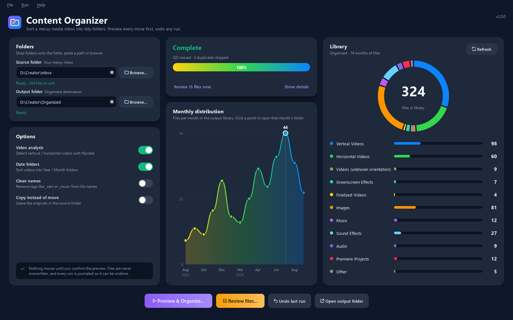

<div align="center">

# Content Organizer

**Point it at a messy footage dump. It sorts vertical clips (Shorts, Reels, TikTok) from horizontal ones (YouTube) by reading each file's real dimensions with ffprobe, rotation included. You preview every move first, and you can undo any run.**

[](https://github.com/JakeeUp/Content-Organizer/actions/workflows/ci.yml)
[](https://www.python.org/downloads/)
[](LICENSE)
[](https://github.com/astral-sh/ruff)



<!-- TODO: demo GIF (drop a folder -> preview -> organize -> undo) -->

</div>

---

## Why?

Creators shoot on phones, cameras and screen recorders, and everything lands in one folder. Before you can edit, you have to work out which clips are 9:16 and which are 16:9, and file names won't tell you. Phones make it worse: they often store a portrait video as a 1920x1080 frame with a "rotate 90°" flag, so naive tools file it as landscape.

General-purpose organizers such as [organize](https://github.com/tfeldmann/organize), [phockup](https://github.com/ivandokov/phockup) and [elodie](https://github.com/jmathai/elodie) sort by date or file type. As far as I could find, none of them sorts video by orientation. Content Organizer is built for that one job, and it is careful with your files while it does it.

## Features

| | Feature | What it means |
|---|---|---|
| 🛡️ | **Dry-run preview** | See every planned move (source, destination and the reason) before anything changes. Works in the GUI and with `--dry-run`. |
| ↩️ | **Undo journal** | Each operation is written to a JSON-lines journal as it happens. `content-organizer undo` (or the GUI button) reverses the last run, even one that was interrupted. |
| 📋 | **Copy mode** | Use `--copy` to leave the inbox untouched while you try it out. |
| 🔁 | **Duplicate detection** | If the destination already holds a file of the same size **and the same SHA-256**, the new copy is skipped and reported. It is never stored twice. |
| 🚫 | **Never overwrites** | Files with the same name but different content get `name_1.ext`, `name_2.ext`, and so on. Cross-drive moves copy, verify the size, and only then delete the original. |
| 🧹 | **Skips junk** | Leaves alone hidden and system files (`desktop.ini`, `Thumbs.db`, `.DS_Store`), partial downloads (`*.part`, `*.crdownload`), symlinks, and Premiere/After Effects cache and auto-save folders. |
| 🪆 | **Output-inside-source protection** | You can put the output folder inside the inbox. It is excluded from the scan, so earlier results are never re-sorted. |
| 📐 | **Rotation-aware orientation** | Reads the stream size, the `rotate` tag, the display-matrix rotation and the sample aspect ratio. A portrait iPhone clip goes to `VerticalVideos`. |
| 📅 | **Date folders** | Videos go into `YYYY/MM - Month` folders based on the **recording date** in the file (ffprobe `creation_time`), falling back to the modified time. These folders sort correctly and don't depend on your system language. |
| 🏷️ | **Tag overrides** | A whole-word tag in the file name overrides detection: `clip_vert.mp4` matches `vert`, but `vertigo.mp4` doesn't. |
| 📊 | **Dashboard** | A ring chart, per-category bars and a month-by-month chart of your output library. Click a month to open its folder. The CLI equivalent is `content-organizer stats`. |
| 🔍 | **Review queue** | Files the rules couldn't place confidently (`Videos`, `Other`) can be filed by hand, one at a time, into any category. There's an image preview and number-key shortcuts, and every review move is journaled. |
| 🖥️ | **CLI + GUI** | A scriptable command line and a PyQt6 desktop app share the same Qt-free core. |
| ⚙️ | **Configurable** | Extensions, tags, folder names and date layout live in a TOML file. |

## Quickstart

### 1. Install

**Desktop app, no Python needed:** every [release](https://github.com/JakeeUp/Content-Organizer/releases/latest) has:

| File | For |
|---|---|
| `ContentOrganizer.exe` | Windows. A single portable executable |
| `ContentOrganizer-macos.zip` | macOS. Unzip it and move `ContentOrganizer.app` to Applications |
| `content_organizer-*.whl` / `.tar.gz` | Python wheel and sdist, for `pip install` without Git |

> [!NOTE]
> The builds aren't code-signed. Windows SmartScreen may show "Windows protected your PC": click **More info → Run anyway**. On macOS, right-click the app and choose **Open** the first time.

**With pipx** (recommended for the CLI; installs into its own environment):

```bash
# CLI only
pipx install "git+https://github.com/JakeeUp/Content-Organizer.git"

# CLI + desktop GUI
pipx install "content-organizer[gui] @ git+https://github.com/JakeeUp/Content-Organizer.git"
```

**With pip:**

```bash
pip install "content-organizer[gui] @ git+https://github.com/JakeeUp/Content-Organizer.git"
```

**From source:**

```bash
git clone https://github.com/JakeeUp/Content-Organizer.git
cd Content-Organizer
python -m venv .venv
# Windows: .venv\Scripts\activate    macOS/Linux: source .venv/bin/activate
pip install -e ".[gui]"
```

This installs two commands: `content-organizer` (CLI) and `content-organizer-gui` (desktop app). `python -m content_organizer` and `python -m content_organizer.gui` work too.

### 2. Get FFmpeg (for orientation detection)

Detecting orientation needs `ffprobe`, which ships with FFmpeg. Without it everything else still works, but videos go to `Videos/` instead of `VerticalVideos/` or `HorizontalVideos/`.

| OS | Command |
|---|---|
| Windows | `winget install Gyan.FFmpeg`, or click **Install FFmpeg** in the app (a one-click download, SHA-256 verified and installed per user; also available under **Help → Install FFmpeg…**) |
| macOS | `brew install ffmpeg` |
| Debian/Ubuntu | `sudo apt install ffmpeg` |
| Fedora | `sudo dnf install ffmpeg` |

Check your setup:

```console
$ content-organizer doctor
[ok]   ffprobe: C:\...\ffmpeg-9.0.2-full_build\bin\ffprobe.EXE
       ffprobe version 9.0.2-full_build-www.gyan.dev Copyright (c) 2007-2026 the FFmpeg developers
[ok]   config: C:\Users\you\AppData\Local\content-organizer\config.toml (not present, using defaults)
[info] log file: C:\Users\you\AppData\Local\content-organizer\Logs\content-organizer.log
[info] ffmpeg install dir: C:\Users\you\AppData\Local\content-organizer\ffmpeg
[info] content-organizer 2.0.0, Python 3.14.3
```

## Usage

### Desktop app

```bash
content-organizer-gui        # or: python -m content_organizer.gui
```

The window has a sidebar with four pages: **Organize**, **Library**, **Review** and **Settings** (**Ctrl+1**–**Ctrl+4**). On narrow windows the sidebar shrinks to icons. The status line at the bottom of the sidebar shows whether video analysis is available; click it to open Settings.

1. **Choose folders** on the Organize page. Drag a folder onto the **Source folder** (your inbox) and **Output folder** fields, paste a path, or click **Browse…**. Each field checks the path as you type: it shows how many files are ready to sort, says that a missing output folder will be created, and warns you if the output sits inside the source.
2. **Set the options:** *Video analysis* (ffprobe), *Date folders*, *Clean names* and *Copy instead of move*. They are saved as soon as you change them. If FFmpeg is missing, a notice explains what that means. On Windows it has an **Install FFmpeg** button, and on macOS and Linux it shows how to install it. **Not now** hides the notice for good.
3. **Click Preview & organize… (Ctrl+Enter).** Every planned move appears in a table you can filter by category chips or file name. Files that need review and possible duplicates are marked. Nothing has changed yet. Click **Organize N files** to go ahead, or **Back** to cancel.
4. **Watch it run.** The Activity card shows progress and the current file. **Cancel** (or **Esc**) stops after the current file, and files already done stay done and are in the journal. When it finishes you get a summary (moved, duplicates skipped, failures), **Show details**, and a **Review N files now** link.
5. **Recent runs** lists the latest runs for the output folder. **Undo latest** (or **Ctrl+Z**) asks for confirmation, then puts the files from the newest run back.
6. **Review (Ctrl+R)** goes through everything in `Videos` and `Other` one file at a time; the sidebar badge shows how many are waiting. Images show a preview. Press the **number key** on a category button to file the current file, **→**/**S** to skip, **←** to go back, and **O** to open the file. Each move made here is journaled as its own small run, so Undo takes back the most recent review move first.
7. **Library** shows the output folder's totals, a **Monthly distribution** chart (click a bar, or use ←/→ and Enter, to open that month's folder) and a per-category breakdown. **Refresh** or **F5** rescans; **Open folder** (Ctrl+Shift+O) opens it in your file manager.
8. **Settings** switches between System, Light and Dark appearance, installs or re-detects FFmpeg, and opens the config and log folders.

The menus have the same actions: **File** (Open Output Folder, Quit), **Run** (Preview & Organize, Review Files, Undo Last Run, Refresh Library, Cancel), **View** (the four pages) and **Help** (Install FFmpeg, About). The app remembers your folders, options, appearance and last page.

### Command line

```text
content-organizer organize SRC OUT [-n/--dry-run] [--copy] [--no-date-folders]
                                   [--clean-names] [--no-probe] [--config FILE] [-v]
content-organizer undo OUT
content-organizer stats FOLDER
content-organizer doctor
```

**Preview first.** This is real output from a sample inbox. One clip in it is an iPhone-style 1920x1080 file with a 90° rotation flag:

```console
$ content-organizer organize Inbox Organized --dry-run
CATEGORY            SOURCE                                DESTINATION
FinalizedVideos     channel_trailer_final.mp4         ->  FinalizedVideos\2024\05 - May\channel_trailer_final.mp4
GreenscreenEffects  chroma_explosion_greenscreen.mp4  ->  GreenscreenEffects\chroma_explosion_greenscreen.mp4
VerticalVideos      dance_trend.mov                   ->  VerticalVideos\2024\03 - March\dance_trend.mov
PremiereProjects    edit_v2.prproj                    ->  PremiereProjects\edit_v2.prproj
HorizontalVideos    holiday_greenland.mp4             ->  HorizontalVideos\2024\05 - May\holiday_greenland.mp4
HorizontalVideos    intro_music.mp4                   ->  HorizontalVideos\2024\05 - May\intro_music.mp4
Music               lofi_beat_music.mp3               ->  Music\lofi_beat_music.mp3
Other               notes.txt                         ->  Other\notes.txt
HorizontalVideos    square_teaser.mp4                 ->  HorizontalVideos\2024\04 - April\square_teaser.mp4
Images              thumbnail.png                     ->  Images\thumbnail.png
HorizontalVideos    vlog_ep12.mp4                     ->  HorizontalVideos\2024\03 - March\vlog_ep12.mp4
Audio               voiceover_take3.m4a               ->  Audio\voiceover_take3.m4a
SoundEffects        whoosh_sfx.wav                    ->  SoundEffects\whoosh_sfx.wav
VerticalVideos      phone dump\IMG_4821.mov           ->  VerticalVideos\2024\04 - April\IMG_4821.mov

Dry run: 14 files would be organized into C:\Users\you\Videos\Organized
  Vertical Videos                     2
  Horizontal Videos                   4
  Greenscreen Effects                 1
  Finalized Videos                    1
  Images                              1
  Music                               1
  Sound Effects                       1
  Audio                               1
  Premiere Projects                   1
  Other                               1
1 file could not be placed confidently (Videos/Other).
No files were changed.
```

A few things to notice:

- `IMG_4821.mov` went to **Vertical**, not Horizontal, because its rotation flag was applied.
- `holiday_greenland.mp4` does **not** match the `green` tag, because tags must be whole words.
- `intro_music.mp4` stays a **video**, because audio tags never pull a video into `Music/`.
- `desktop.ini` and `big_download.mp4.part` in the same inbox were skipped.

**Run it, then undo it:**

```console
$ content-organizer organize Inbox Organized
14 files moved to C:\Users\you\Videos\Organized
Undo with: content-organizer undo "C:\Users\you\Videos\Organized"

$ content-organizer organize Inbox Organized        # a copy of thumbnail.png reappeared in the inbox
0 files moved to C:\Users\you\Videos\Organized
1 duplicate skipped (already in output):
  thumbnail.png

$ content-organizer undo Organized    # the skipped thumbnail.png is still in the inbox
Restored 13 moved files, removed 0 copies.
  could not undo C:\Users\you\Videos\Inbox\thumbnail.png: ...\Inbox\thumbnail.png already exists; not overwriting
Remaining operations were kept; run undo again after fixing them.
```

Undo never overwrites either. It restores everything it safely can and keeps the rest in the journal so you can try again.

**See what's in a library:**

```console
$ content-organizer stats Organized
14 files in C:\Users\you\Videos\Organized

CATEGORY             FILES
Vertical Videos      2
Horizontal Videos    4
...

MONTH        FILES
2024-03 Mar  2
2024-04 Apr  2
2024-05 May  3
```

Exit codes: `0` success · `1` finished with problems (failed files, nothing to undo, `doctor` found issues, an unexpected OS error) · `2` usage, config or path error · `130` interrupted.

## How categorization works

Each file goes through three steps, in order:

1. **Extension → media type.** `.mp4` is a video, `.wav` is audio, `.prproj` is a project, and so on. The extension is always decided first, so tags can't move a `.png` into `Music/`.
2. **Naming tags → category.** The file name (without extension) is split on `_`, `-`, `.` and spaces, and each piece is compared, case-insensitively, against the tag list for that media type. If several tags match, the category listed first wins.
3. **ffprobe → orientation** (untagged videos only). The display size is the stored width × height with the sample aspect ratio applied, and swapped when the rotation is 90° or 270°. Taller than wide means vertical. Wider than tall, or square, means horizontal. If it can't be determined, the file goes to `Videos`.

### Categories

| Folder | Gets |
|---|---|
| `VerticalVideos` | Videos tagged vertical, or with display height > width |
| `HorizontalVideos` | Videos tagged horizontal, or with display width ≥ height (square counts as horizontal: it isn't Shorts-ready) |
| `Videos` | Videos whose orientation is unknown (no ffprobe, `--no-probe`, unreadable file). **Flagged for review.** |
| `GreenscreenEffects` | Videos tagged greenscreen |
| `FinalizedVideos` | Videos tagged `final`, or sent here from the review queue |
| `Images` | `.jpg .jpeg .png .gif .bmp .webp .heic .tif .tiff` |
| `Music` | Audio tagged music |
| `SoundEffects` | Audio tagged sfx |
| `Audio` | All other audio (`.mp3 .wav .flac .m4a .aac .ogg .opus .aif .aiff .wma`) |
| `PremiereProjects` | `.prproj .aep .aepx .mogrt` |
| `Other` | Any other file that wasn't skipped. **Flagged for review.** |

Video extensions: `.mp4 .mov .m4v .avi .mkv .webm .flv .wmv .mts .m2ts .3gp`.

### Naming tags

Listed in priority order. The first match wins.

| Tags (whole words, any case) | Applies to | Category |
|---|---|---|
| `final` | video | `FinalizedVideos` |
| `greenscreen`, `green`, `chroma` | video | `GreenscreenEffects` |
| `vertical`, `vert`, `9x16` | video | `VerticalVideos` |
| `horizontal`, `horiz`, `16x9` | video | `HorizontalVideos` |
| `sfx`, `soundeffect`, `sound` | audio | `SoundEffects` |
| `music`, `song` | audio | `Music` |

Examples: `Beach_VERT-take2.mp4` → Vertical · `logo reveal 16x9.mov` → Horizontal · `my_soundtrack.mp3` → Audio (`soundtrack` ≠ `sound`).
With `--clean-names`, matched tags are removed from the name: `Beach_VERT-take2.mp4` becomes `Beach-take2.mp4`. Other separators are kept, and a name is never reduced to nothing.

### Folder layout: before and after

```text
Inbox/  (abridged)                       Organized/
├── vlog_ep12.mp4                        ├── VerticalVideos/
├── dance_trend.mov                      │   └── 2024/
├── channel_trailer_final.mp4            │       ├── 03 - March/dance_trend.mov
├── whoosh_sfx.wav                       │       └── 04 - April/IMG_4821.mov
├── lofi_beat_music.mp3        ──▶       ├── HorizontalVideos/
├── thumbnail.png                        │   └── 2024/03 - March/vlog_ep12.mp4
├── edit_v2.prproj                       ├── FinalizedVideos/2024/05 - May/channel_trailer_final.mp4
├── desktop.ini         (skipped)        ├── SoundEffects/whoosh_sfx.wav
└── phone dump/                          ├── Music/lofi_beat_music.mp3
    └── IMG_4821.mov                     ├── Images/thumbnail.png
                                         ├── PremiereProjects/edit_v2.prproj
                                         └── .content-organizer/journal-<timestamp>.jsonl  (undo log)
```

Date folders apply to `VerticalVideos`, `HorizontalVideos`, `Videos` and `FinalizedVideos` by default (set by `[layout]`). Turn them off with `--no-date-folders`. Sub-folders in the inbox are flattened, and the empty folders they leave behind are not deleted.

## Configuration

Everything rule-related lives in a TOML file that is merged over the [built-in defaults](src/content_organizer/defaults.toml). You only write the keys you want to change. Tables merge key by key, and **a list replaces the default list**.

The user config path is shown by `content-organizer doctor`:

| OS | Default path |
|---|---|
| Windows | `%LOCALAPPDATA%\content-organizer\config.toml` |
| macOS | `~/Library/Application Support/content-organizer/config.toml` |
| Linux | `~/.config/content-organizer/config.toml` |

```toml
# config.toml: rename folders for your workflow and add some tags
[folders]
VerticalVideos = "Shorts"
HorizontalVideos = "YouTube"

[tags]
Music = ["music", "song", "bgm"]        # replaces the default list
VerticalVideos = ["vertical", "vert", "9x16", "short", "reel", "tiktok"]

[extensions]
# Lists replace the defaults, so repeat the ones you want to keep
video = [".mp4", ".mov", ".m4v", ".mkv", ".webm", ".mts", ".mxf", ".braw"]
```

You can also pass a file for one run with `--config my-rules.toml`. An invalid config (unknown category, two categories sharing a folder name, bad TOML) is rejected with a clear error before any file is touched.

➡️ **Full reference:** [docs/configuration.md](docs/configuration.md)

## Safety and undo

Content Organizer moves your files, so it is built to be boring and predictable:

- **Plan, then execute.** A plan is built without touching anything: it reads file sizes and runs ffprobe, nothing more. Dry runs and the GUI preview show that exact plan.
- **Nothing is ever overwritten.** On a name clash, identical content (same size and SHA-256) is skipped as a duplicate, and different content gets a `_N` suffix.
- **Every operation is journalled** to `<output>/.content-organizer/journal-*.jsonl` and flushed straight away, so even a crashed or cancelled run can be undone. The journal is opened before the first file is touched: if it can't be written, nothing moves. Review moves in the GUI are journaled too.
- **Undo is conservative.** If something new now sits at a file's original location, that file is left where it is and reported. Copies (from `--copy` runs) are only deleted if their size still matches **and the original is still in the source**. If you have since deleted the originals, the copies are kept, because they are now your only copy. After a partial undo the journal keeps the remaining operations, so you can fix the problem and run `undo` again.
- **Cross-drive moves** copy to a temporary `.co-partial` file, check the size, rename it into place, and only then delete the source.
- **Source and output can't be the same folder**, and an output inside the source is excluded from the scan.

> [!NOTE]
> Every file that isn't skipped gets organized, including non-media files, which go to `Other/`. If your inbox holds **Premiere/After Effects project folders**, moving their media will break the project's links. Organize footage *before* importing it, or exclude project folders. Do a `--dry-run` or `--copy` run first if you're unsure.

## Project structure

```text
src/content_organizer/
├── categories.py        # Category / MediaType enums: the shared vocabulary
├── rules.py             # pure functions: categorize, tag tokenizer, clean names, date folders
├── probe.py             # ffprobe discovery + rotation-aware VideoInfo parsing
├── scanner.py           # safe directory walk (skips, pruning, sorted output)
├── planner.py           # build a Plan of moves without touching files
├── executor.py          # apply a Plan, SHA-256 duplicate check, journal, undo
├── stats.py             # per-category / per-month library stats (Library page)
├── config.py            # TOML config: defaults.toml + user overrides, validated
├── defaults.toml        # built-in extensions, tags, folders, skip lists
├── ffmpeg_install.py    # Windows one-click FFmpeg download (SHA-256 verified)
├── logging_setup.py     # rotating log file in the per-user log dir
├── cli.py               # argparse CLI: organize / undo / stats / doctor
└── gui/                 # PyQt6 desktop app (the only package that imports Qt)
    ├── app.py           # QApplication bootstrap, entry point for content-organizer-gui
    ├── main_window.py   # shell: sidebar, page stack, menus and shortcuts
    ├── context.py       # AppContext: shared settings, options, ffprobe, tasks, review count
    ├── pages/           # organize, library, review and settings pages
    ├── preview_dialog.py  # filterable dry-run table + confirm
    ├── ffmpeg_setup.py  # FFmpeg download flow with a progress dialog
    ├── workers.py       # background tasks wrapping plan / execute / undo / stats / install
    ├── presenters.py    # Qt-free view-model text and validation (unit-tested)
    ├── theme.py, icons.py  # light/dark palettes, style sheet, theme-aware SVG icons
    └── widgets/         # sidebar, cards, folder field, monthly chart, plan table, ...
tests/                   # pytest suite (+ tests/gui with pytest-qt); real-ffmpeg tests marked `ffmpeg`
docs/                    # architecture, configuration reference, screenshot
packaging/               # PyInstaller entry script for the Windows exe / macOS app
.github/                 # CI + release workflows, issue/PR templates, Dependabot
```

For how the pieces fit together, see [docs/architecture.md](docs/architecture.md).

## Development

```bash
git clone https://github.com/JakeeUp/Content-Organizer.git
cd Content-Organizer
python -m venv .venv && source .venv/bin/activate   # Windows: .venv\Scripts\activate
pip install -e ".[dev,gui]"
pre-commit install
```

| Task | Command |
|---|---|
| Run tests | `pytest` |
| Skip real-FFmpeg tests | `pytest -m "not ffmpeg"` |
| Coverage | `pytest --cov` |
| Lint and format | `ruff check . && ruff format .` |
| Type check (core) | `mypy` |
| All hooks | `pre-commit run --all-files` |

The core is fully unit-tested without FFmpeg: tests inject a fake prober and canned ffprobe JSON (an iPhone display matrix, an Android `rotate` tag, a cover-art-first stream). GUI tests use `pytest-qt`. CI runs lint, type checks and tests on **Ubuntu, Windows and macOS × Python 3.11–3.13**, and builds the sdist and wheel. Pushing a `v*` tag builds the Windows exe and the macOS app and attaches them to a GitHub Release.

## Roadmap

- [ ] **Watch mode:** organize new files as they arrive in the inbox (`watchdog`)
- [ ] **EXIF dates for images** with Pillow (`DateTimeOriginal`), so photos get date folders too
- [ ] **Send to Recycle Bin** (`send2trash`) as a conflict option
- [ ] **Square (1:1) and 4:5 buckets** for Instagram, with an aspect-ratio tolerance
- [ ] **Parallel ffprobe** for very large inboxes
- [ ] Path templates (`{category}/{year}/{month}`)

Ideas and votes are welcome in [Issues](https://github.com/JakeeUp/Content-Organizer/issues).

## Contributing

Pull requests are welcome. See [CONTRIBUTING.md](CONTRIBUTING.md) for setup, commit style, and how to add a category or tag. Release notes are in [CHANGELOG.md](CHANGELOG.md).

## License

[MIT](LICENSE) © 2026 Jacob Fernandez

## Acknowledgements

- [FFmpeg](https://ffmpeg.org/): `ffprobe` does the real work of reading video metadata. Windows builds come from [gyan.dev](https://www.gyan.dev/ffmpeg/builds/).
- Ideas borrowed from other organizers:
  - [organize](https://github.com/tfeldmann/organize): simulation mode and conflict handling
  - [phockup](https://github.com/ivandokov/phockup): checksum-based duplicate skipping
  - [elodie](https://github.com/jmathai/elodie): date-based layouts
- [platformdirs](https://github.com/tox-dev/platformdirs) for per-user config, log and data paths, and [PyQt6](https://www.riverbankcomputing.com/software/pyqt/) for the GUI.
