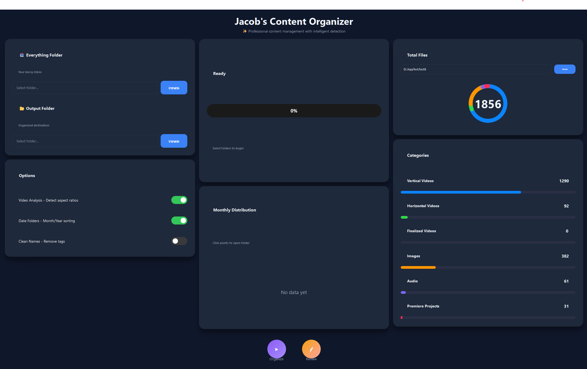

# Content Organizer

Intelligent file organization tool for content creators. Automatically categorizes videos by aspect ratio, organizes files by type and date, and provides visual analytics.

## Features

- **Smart Video Detection** - Automatically categorizes vertical vs horizontal videos using FFmpeg
- **Date-Based Organization** - Optional Year/Month folder structure
- **Multi-Format Support** - Videos, images, audio, Premiere Pro projects
- **Visual Analytics** - Interactive charts showing file distribution over time
- **Batch Processing** - Handles thousands of files efficiently
- **Name Cleaning** - Removes naming tags while organizing

## Installation

```bash
git clone https://github.com/yourusername/content-organizer.git
cd content-organizer
pip install -r requirements.txt
```

## Usage

```bash
python main.py
```

Or run directly from src:

```bash
cd src
python gui_pyqt.py
```

## Requirements

- Python 3.11+
- PyQt6
- FFmpeg (auto-downloads on first run)

## Building Executable

```bash
pyinstaller --onefile --windowed --name "ContentOrganizer" main.py
```

## File Categories

- **VerticalVideos** - Videos with height > width
- **HorizontalVideos** - Videos with width ≥ height
- **FinalizedVideos** - Manually categorized completed videos
- **Images** - JPG, PNG, GIF, etc.
- **Audio** - MP3, WAV, FLAC, etc.
- **PremiereProjects** - .prproj, .aep, .mogrt files

## Naming Conventions

Files can be pre-categorized using tags:

- `_vertical`, `_vert` → Vertical Videos
- `_horizontal`, `_horiz` → Horizontal Videos  
- `_sfx`, `_soundeffect` → Sound Effects
- `_music`, `_song` → Music
- `_premiere`, `_project` → Premiere Projects

## Screenshots



## License

MIT License - see LICENSE file

## Contributing

Pull requests welcome!
