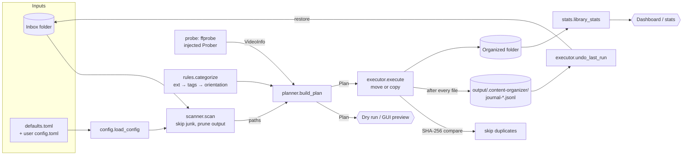

# Architecture

Content Organizer is a small application split into layers: a **pure, Qt-free core library** (`content_organizer.*`) with two thin front ends on top, the argparse CLI and the PyQt6 GUI. Everything that decides *where a file goes* can be tested without a filesystem, without FFmpeg, and without a display.

## Module map

| Layer | Module | Responsibility | I/O? |
|---|---|---|---|
| Vocabulary | `categories` | `Category` and `MediaType` enums, labels, `REVIEW_CATEGORIES` | none |
| Rules | `rules` | `categorize()`, the tag tokenizer, `clean_filename()`, `date_folder()` | **none (pure)** |
| Config | `config` | Loads `defaults.toml`, merges the user TOML, validates, returns a frozen `Config` | reads config files |
| Media | `probe` | Finds `ffprobe`, runs it, and parses its JSON into a `VideoInfo` with rotation-aware `orientation` | subprocess |
| Discovery | `scanner` | Sorted, safe directory walk: skips, pruning, the journal folder | reads dirs |
| Planning | `planner` | Builds a `Plan` of `PlannedMove(src, dest, category, reason)`, and resolves collisions inside the plan | `stat` + probe only |
| Execution | `executor` | Applies a `Plan` (move or copy), checks duplicates by SHA-256, writes the JSON-lines journal, undo | **writes files** |
| Insights | `stats` | Per-category and per-month counts of a folder for the Library page and `stats` (no ffprobe) | reads dirs |
| Setup | `ffmpeg_install` | Windows-only FFmpeg download: streamed, cancellable, SHA-256 verified | network, writes |
| Setup | `logging_setup` | Rotating log file in the per-user log dir. Only entry points call it | writes log |
| Front end | `cli` | `organize`, `undo`, `stats`, `doctor`, and exit codes | stdout |
| Front end | `gui/` | PyQt6 app: `main_window` (sidebar shell), `pages/` (Organize, Library, Review, Settings) sharing state through `context.AppContext`, `preview_dialog`, `widgets/`. `workers` run core calls off the UI thread and turn callbacks into signals. `presenters` hold the Qt-free view-model text and validation | Qt |

The dependency direction is strictly downward: `gui`/`cli` → `executor`/`planner`/`stats` → `scanner`/`probe`/`rules` → `config` → `categories`. Nothing in the core imports `gui`, and nothing in the core imports Qt.

## Data flow

### One run, step by step

1. **Configure.** `load_config()` merges the user TOML over the bundled defaults and validates it into an immutable `Config`. Bad config fails here, before anything is scanned.
2. **Check paths.** `check_paths()` resolves both folders and rejects a missing source, an output that is a file, or source == output. An output *inside* the source is allowed, because the scanner prunes it.
3. **Scan.** `scanner.scan()` yields files in sorted order. It skips hidden and system files, symlinks, `skip_files`/`skip_dirs` globs, the `.content-organizer` journal folder and the excluded output folder.
4. **Plan.** For each file, `build_plan()` works out the media type from the extension and, for videos, calls the `Prober`. `rules.categorize()` picks the category and a human-readable reason. The planner adds the date folder and the optional clean name, and resolves name collisions against both the disk and earlier planned moves. A same-size file already at the destination is marked `possible_duplicate`. **Nothing is written.**
5. **Preview** (optional). `cli.print_plan()` or the GUI table renders the plan. A dry run stops here.
6. **Execute.** `execute()` goes through the plan. It checks `cancel` before each file, and moves or copies. If the destination exists, it compares SHA-256: identical files are skipped as duplicates, and different ones get a fresh `name_N`. It appends a journal line and flushes it, then reports progress.
7. **Undo** (optional). `undo_last_run()` replays the newest journal in reverse. Files that now conflict are kept and reported, and the journal is rewritten with the remaining operations so you can try again.

## Design decisions

### Plan, then execute
Deciding and doing are separate steps. The `Plan` is a plain list of dataclasses, so it gives:
- **dry run and GUI preview for free**, showing exactly what the executor will do
- **counts for the UI before anything moves**
- **testable logic**: planner tests check a list, not a mutated directory tree
- a natural point for **cancel and progress**, since each step works through a list

The GUI review dialog uses the same path: each manual "move to category" is a one-file `Plan` passed to `execute()`. It gets the same no-overwrite and duplicate rules and its own journal, which is why **Undo last run** takes back the most recent review move first. No file is ever moved outside the executor.

The trade-off is that the disk can change between planning and executing. The executor handles that: it re-checks the destination for every file and never overwrites, picking a new `name_N` if something appeared since the plan was made.

### Dependency-injected prober
`Prober = Callable[[Path], VideoInfo | None]`. The planner never runs a subprocess itself. In production `make_prober(find_ffprobe())` supplies the real one. Tests pass a `FakeProber({"clip.mp4": VERTICAL})`, so the full planning pipeline runs in milliseconds with no FFmpeg installed. ffprobe JSON parsing is a separate pure function (`parse_ffprobe_json`), tested against canned output from real devices in `tests/data/`.

### Rotation-aware orientation lives in the data model
`VideoInfo` stores what ffprobe reports: stored width and height, rotation, and sample aspect ratio. Orientation is a derived property (`display_size` → `orientation`). Both the legacy `tags.rotate` and the display-matrix `side_data_list[].rotation` are honoured, and the first real video stream is used, skipping attached cover art. This was the main correctness bug in v1.

### No import-time side effects
Importing any core module does not configure logging, change `sys.stdout`, create files or modify `PATH`. Only the entry points (`cli.main`, `gui.app.main`) call `configure_logging()`. This keeps pytest output capture working, makes the library safe to embed, and lets the windowed PyInstaller build (where `sys.stderr is None`) start reliably.

### Qt-free core
The GUI is the only package that imports PyQt6. Long-running core functions accept plain `progress` callbacks and a `threading.Event` for cancel. The GUI runs them on a worker thread and re-emits the callbacks as Qt signals. This means:
- the CLI installs without Qt (`pip install content-organizer`, where `[gui]` is optional)
- the core is tested and type-checked (mypy with `disallow_untyped_defs`) without a display
- the GUI can be rewritten without touching the rules

### Configuration as data
Extensions, tags, folder names, date layout and skip lists live in `defaults.toml`, read with the stdlib `tomllib`. A user file merges over it. A full rule engine (organize-style YAML filters and actions) was considered and rejected as overkill: creators need to rename folders and add tags, not write programs.

### Append-only, crash-safe journal
The journal is JSON Lines: one header record, then one record per operation, each flushed as soon as it is written. It is opened **before the first file is touched**, so if the journal can't be written, nothing moves at all. A journal that ends up with no operations is deleted when it is closed, so a run that does nothing leaves nothing behind. An interrupted run is still fully undoable up to the last completed file, and a torn final line is ignored when the journal is read.

### Safe file operations
- **Never overwrite:** collisions get a `_N` suffix, and identical content (size and SHA-256) is a skipped duplicate.
- **Cross-device moves** copy to `<dest>.co-partial`, check the size, rename into place, and only then delete the source.
- **Per-file errors don't abort the run.** They are collected in `RunResult.errors` and shown to the user.
- **No `PATH` mutation:** ffprobe is resolved to an absolute path and called directly. On Windows it runs with `CREATE_NO_WINDOW`.
- **FFmpeg download fails closed:** if the published `.sha256` is missing or doesn't match, nothing is installed. Only `bin/*.exe` members are extracted.

## Testing strategy

| Layer | Approach |
|---|---|
| `rules`, `categories` | Pure unit tests: tag tokenizer positives and negatives (`vertigo`, `greenland`, `soundtrack`), media-type gating, clean-name edge cases, date folders |
| `probe` | Parse canned ffprobe JSON (iPhone display matrix −90, Android `rotate=270` with an epoch date, cover-art-first). Garbage output and a mocked subprocess check that `probe()` never raises |
| `scanner` | `tmp_path` trees: hidden and system files, skip globs, output pruning, the journal folder, sorted order |
| `planner` | `FakeProber` + `tmp_path`: collisions inside a plan and against the disk, date buckets, cancel, `PlanError` cases |
| `executor` | Real file moves in `tmp_path`: duplicates, rename-on-conflict, the journal contents, undo (full, partial and retry), cancel mid-run, per-file errors, cross-device fallback, torn journal lines |
| `config` | Merging semantics and every validation error |
| `ffmpeg_install` | Injected fake `opener`: progress, cancel, checksum mismatch, missing checksum, non-Windows |
| `cli` | `main([...])` with captured output and exit codes |
| Real FFmpeg | `@pytest.mark.ffmpeg`. Generates tiny real videos (including a rotated one) and probes them. Skipped automatically if FFmpeg isn't on `PATH` |
| GUI | `tests/gui/` uses `pytest-qt` with `QT_QPA_PLATFORM=offscreen`: main window, dialogs, widgets, workers, plus plain unit tests for the Qt-free `presenters` |
| Properties and adversarial cases | `hypothesis` checks that `clean_filename` keeps the extension and is idempotent, and that `categorize` never raises. Adversarial tests cover odd path layouts, Unicode and very long names, locked files, mocked cross-device moves, cancel followed by undo, and corrupt journals and ffprobe JSON |

Fixtures in `tests/conftest.py` redirect the config, log and FFmpeg directories to a temp folder for every test (`isolated_user_dirs`, autouse), so the suite never touches your real settings.
